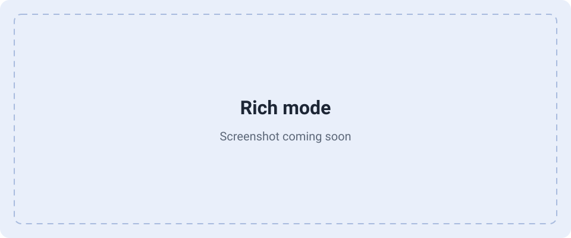
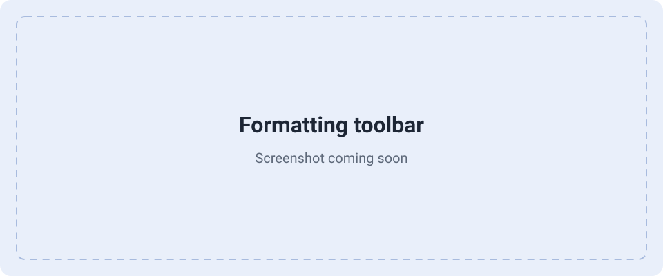

# Editor

Markydowny is a viewer first, with an editor for the moment you spot a typo. The editor shows the markdown source; saving writes it back to the file.

## Edit and Done

Click **Edit** in the header, or press <kbd>⌘E</kbd> (<kbd>Ctrl+E</kbd> on Windows and Linux), to switch from the rendered document to its source. The editor opens at the part of the document you were reading.

Click **Done**, or press <kbd>⌘E</kbd> again, to go back to the rendered view, near where your cursor was. If you have unsaved changes, Markydowny asks before discarding them.

## New file

To start a document from scratch, click **New file** on the drop zone. In the app, choose **File > New** or press <kbd>⌘N</kbd> (<kbd>Ctrl+N</kbd> on Windows and Linux) too: on a Mac it opens in a new tab, elsewhere in a new window, unless the window in front is showing the drop zone, which then takes it. The document is called *Untitled* and opens straight in the editor.

The first save asks where to put it:

| Where | First save |
| --- | --- |
| The app | The Save panel, named `Untitled.md`, in the folder of the last file you opened |
| Chrome, Edge and other Chromium browsers | The browser's Save dialog, named `Untitled.md` |
| Safari and Firefox | **Download** saves `Untitled.md`, usually to your Downloads folder |

Cancel and the document stays open and unsaved. Once it's saved it's a file like any other: the title becomes the file's name, later saves write it in place, and it live-reloads. In the app it's also added to **File > Open Recent**. An existing file is only replaced if you say so when the Save panel asks.

Closing the window or tab of an untitled document you've typed in asks first, as for any unsaved changes; one you never typed in closes without asking. Quitting the app doesn't ask: the document comes back, still *Untitled*, the next time you open Markydowny (see [Unsaved work is kept](#unsaved-work-is-kept)). You can have several untitled documents open at once.

## Save

Press <kbd>⌘S</kbd> (<kbd>Ctrl+S</kbd>) or click **Save**. Save is only enabled while there's something to save.

Where the file goes depends on how you opened it:

| Opened in | Save |
| --- | --- |
| The Mac app | Writes the file in place |
| Chrome, Edge and other Chromium browsers, with **Choose File** or by dropping the file | Writes the file in place, after the browser asks once for permission |
| Safari, Firefox, or any file from a dropped folder | **Download** saves a copy under the same name, usually to your Downloads folder |

When saving in place isn't possible the button reads **Download** instead of **Save**, so you know before you click.

## Only your edits change

Saving changes only the text you edited. Everything else in the file, down to the byte, stays as it was:

- line endings, Windows (`\r\n`) or Unix (`\n`), are kept as the file has them,
- nothing is reformatted: list markers, indentation, trailing spaces and blank lines are untouched, and
- the file's permissions are kept.

That keeps diffs small and means saving never fights a formatter or another tool. In the Mac app, the new text is written to a temporary file and moved over the original, so a crash mid-save never leaves half a file.

## Find and replace

Press <kbd>⌘F</kbd> (<kbd>Ctrl+F</kbd>) while editing to open find and replace at the bottom of the editor. It searches the markdown source, with options for case, whole words and regular expressions, and replaces one match at a time or all of them. Press <kbd>Esc</kbd> to close it. Undo takes back a replacement like any other edit.

While you're reading rather than editing, <kbd>⌘F</kbd> is the browser's own find.

## Word count

While editing, the header shows how many words the document has, and how many are selected (*37 of 1,204 words*). It counts the words a reader sees: link text, image alt text and code count, while markup, link URLs, HTML tags and comments don't. Chinese and Japanese characters count one word each. The count isn't shown on narrow windows.

## Revert

**Revert** throws away your unsaved changes and puts the editor back to the last saved text.

## Unsaved changes

While you have unsaved changes, the document's title starts with a dot (•). Markydowny asks before anything would throw them away: **Done**, **Open another**, dropping another file, or closing the window or tab. Quitting the app doesn't ask, because your changes are kept for next time.

## Unsaved work is kept

You never lose unsaved work. About a second after each change, Markydowny keeps a backup of every document with unsaved changes, untitled ones included, in its own storage. Only **Save** (<kbd>⌘S</kbd>) ever writes to your files: the backup is a copy on the side, never the file itself.

| Where | Where backups go | When they come back |
| --- | --- | --- |
| The Mac app | A `backups` folder in `~/Library/Application Support/com.workingdevshero.markydowny` | The next launch reopens each one in its own tab |
| The Linux app | A `backups` folder in `~/.config/com.workingdevshero.markydowny` | The next launch reopens each one in its own window |
| The web | The browser's storage for markydowny.com (IndexedDB) | On your next visit, the drop zone offers **Restore 2 unsaved documents** |

A document comes back in the editor, still unsaved:

- **An untitled document** is still *Untitled*, and its first save still asks where to put it.
- **A document with a file** reopens that file with your changes as unsaved edits. If the file changed on disk since you started editing, the [*This file changed on disk*](#changed-on-disk) banner asks which to keep, so neither version is lost.
- **A file that was moved or deleted** comes back as an untitled document named after it, with a note saying the file was moved or deleted.

In the app, quitting (<kbd>⌘Q</kbd>, or logging out) doesn't ask about unsaved changes, and even a crash or a force quit loses at most the last second of typing. Closing a window or tab still asks, since that's how you say you're done with a document: **Discard** there throws the backup away too.

On the web, reloading or closing a tab with unsaved changes still asks first. Close it anyway and the backup stays. In Chrome, Edge and other Chromium browsers, restoring a document you opened with **Choose File** or by dropping it reopens the file itself, after the browser asks for permission again. In Safari and Firefox, or if you refuse, it comes back as an untitled document named after the file. In a private window, or with site data blocked, the browser may keep nothing: editing works as before, without backups.

A backup stays until you've restored it and saved or discarded the changes. There's no expiry.

## Changed on disk

Markydowny keeps watching the file while you edit (in the app, and in Chromium browsers; see [Live reload](live-reload.md#browser-support)).

- **With no unsaved changes**, a change on disk is applied to the editor as it happens. Your cursor stays where it is.
- **With unsaved changes**, a banner says *This file changed on disk* and offers:
  - **Reload**: discard your changes and load the file as it is now.
  - **Keep mine**: carry on editing. The next save overwrites the file with your version.

Saving checks the file first, too. If it changed since you started editing, the save stops and the banner appears instead, so a change made elsewhere is never overwritten without your say.

## Rich mode

> **Coming soon.** Rich mode will let you edit the rendered document directly, with a switch between Rich and Markdown. This section will describe it once it ships.

## Formatting toolbar

> **Coming soon.** A toolbar and shortcuts for bold, italics, headings, lists, links and code. This section will describe them once they ship.

