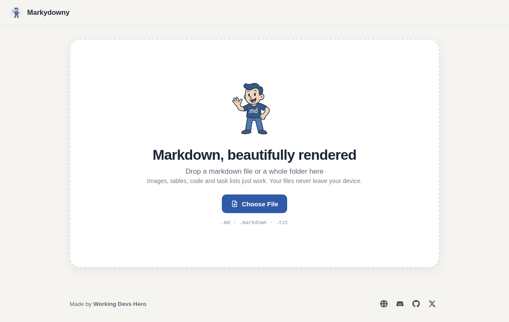

# Getting started

Markydowny renders markdown files, beautifully. Use it on the web at [markydowny.com](https://markydowny.com), or install the Mac app so `.md` files open in it when you double-click them. The two share the same viewer, and in both your files stay on your device.

## On the website

Open [markydowny.com](https://markydowny.com) and either:

- drop a `.md`, `.markdown` or `.txt` file onto the page, or
- click **Choose File** (or press <kbd>Enter</kbd> on the drop zone) and pick one.

The document renders straight away: headings, lists, tables, task lists, fenced code and images. **Open another** in the header takes you back to the drop zone, and the fullscreen button (⛶) hides everything but the document.

Nothing is installed and nothing is uploaded. The page reads the file in your browser, works offline once it has loaded, and has no analytics. See [Privacy](privacy.md).

In Chrome, Edge and other Chromium browsers, a file you choose or drop keeps updating when it changes on disk. See [Live reload & Follow](live-reload.md).

## In the Mac app

[Install the app](install.md), then open markdown files the way you open anything else on a Mac:

- double-click a `.md`, `.markdown`, `.mdown`, `.mkd` or `.mkdn` file in Finder (after making Markydowny the default, see [Install](install.md#make-it-the-default-for-markdown)),
- drag files or folders onto a Markydowny window or its Dock icon,
- use **File > Open…** (<kbd>⌘O</kbd>), or
- from a terminal: `open -a Markydowny README.md`.

Every document opens in its own native tab, and a document that's already open is brought to the front instead of opening twice. See [Tabs & windows](tabs.md).

The app always live-reloads: when another editor or an AI agent changes the file, the window re-renders within a second and keeps your place.

## Folders

Drop a whole folder to read the markdown inside it.

- With one markdown file in the folder, it opens straight away.
- With several, Markydowny lists them (*Multiple markdown files found*) so you can pick one. **Cancel** goes back to the drop zone.
- In the Mac app, the list also offers **Open all as tabs** and **Watch this folder**, which follows whichever file changes next. See [Watching Claude Code](claude-code.md#watch-this-folder).

Hidden folders, `node_modules` and `target` are skipped.

## Relative images and links

Images with relative paths, like `` or `../assets/logo.svg`, are found next to the document:

- **On the web**, drop the folder rather than the single file. The browser only gives the page the files you hand it, so a single dropped file can't reach the images beside it.
- **In the Mac app**, relative paths resolve from the file's location on disk, however you opened it.

Links to other markdown files work too. On the web they open the linked file from the dropped folder; in the Mac app they open it in a new tab. Links to websites open in your browser, and in the app a link to any other kind of file shows it in Finder rather than running it.

Click an image to see it full size; <kbd>Esc</kbd> closes it.

## Light and dark

Markydowny follows your system's appearance, on the web and in the app. There's nothing to set.

## Next

- [Live reload & Follow](live-reload.md): watch a document change as it's edited.
- [Editor](editor.md): edit the markdown and save it.
- [Keyboard shortcuts](shortcuts.md).
